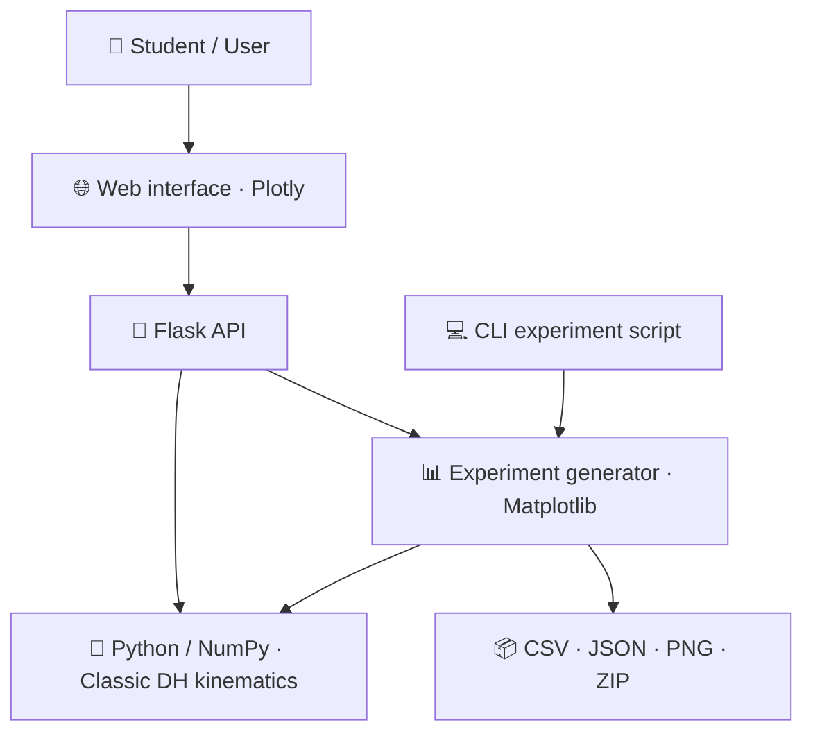

<div align="center">

# 🤖 DH RoboLab 3D

### An Interactive Web Laboratory for Denavit–Hartenberg Forward Kinematics

Explore **3-degree-of-freedom robotic manipulators** with revolute and prismatic joints, inspect transformation matrices, and generate reproducible Cartesian trajectories—all in your browser.


**[🚀 Get Started](#-quick-start) · [🦾 Features](#-features) · [🧪 Experiments](#-reproducible-experiments) · [🧰 Tests](#-automated-tests)**

</div>

---

## 🎯 Overview

**DH RoboLab 3D** is an educational robotics application for studying **forward kinematics using the classic Denavit–Hartenberg (DH) convention**. It connects editable DH parameters with a 3D representation of a three-joint serial manipulator, intermediate coordinate frames, and the resulting end-effector pose.

The application is designed for classroom demonstrations, independent exploration, and computational experiments. Its mathematical engine is written in **Python/NumPy**, exposed through a **Flask** API, and visualized through **Plotly** in the browser.

> 📚 **Educational scope:** This is a kinematics learning and numerical demonstration tool. It does not simulate robot dynamics or establish improvements in student learning outcomes.

## 🦾 Features

- 🎛️ **Editable DH table:** Change joint type and the four classic parameters, `θ`, `d`, `a`, and `α`.
- 🔀 **Revolute and prismatic joints:** Explore all **eight** three-joint sequences: `RRR`, `RRP`, `RPR`, `RPP`, `PRR`, `PRP`, `PPR`, and `PPP`.
- 🧩 **Ready-to-use presets:** Start with `RRR`, `RRP`, `RPP`, `PPP`, or two additional RRR poses.
- 🌐 **Interactive 3D view:** Inspect the robot's DH geometry, joint markers, reference frames, end-effector position, and motion trail.
- 🧮 **Live matrix inspection:** Examine each `Aᵢ`, the accumulated transforms, and the final `T₀³` matrix.
- 📈 **Joint-sweep experiments:** Generate a sampled trajectory by varying one active joint coordinate while holding the others fixed.
- 📦 **Downloadable results:** Export CSV data, JSON metadata, and four PNG plots in a ZIP archive.
- 🌍 **Bilingual interface:** Switch between **English** and **Portuguese** without resetting the current robot configuration.
- 🧪 **Testable numerical core:** Run experiments and automated tests without opening the browser.

## 🚀 Quick Start

### 1. Download the project

```bash
git clone https://github.com/vitor-souza-ime/DHRoboLab3D.git
cd DHRoboLab3D/DH-RoboLab-3D-v3
```

> 🐍 **Requirement:** Python **3.11 or later** is recommended.

### 🪟 Windows — easiest option

Run these files from the `DH-RoboLab-3D-v3` directory, in order:

1. `install_windows.bat` — creates a virtual environment and installs the dependencies.
2. `start_windows.bat` — starts the local Flask server.

Or launch them from a terminal:

```bat
install_windows.bat
start_windows.bat
```

### 🐧 Linux / 🍎 macOS

```bash
python3 -m venv .venv
source .venv/bin/activate
python -m pip install -r requirements.txt
python app.py
```

### 🌐 Open the laboratory

Once the server is running, visit:

**http://127.0.0.1:5000**

The application runs locally. Its bundled Plotly JavaScript file supports the browser visualization without relying on a Plotly CDN.

## 🎮 How to Use

1. 🦾 Select a preset robot configuration, such as **RRR** or **RRP**.
2. 🔧 Edit the DH parameters or change any of the three joint types between **R** and **P**.
3. 🎚️ Move the joint controls to update the manipulator pose.
4. 🔍 Inspect the 3D scene, coordinate frames, end-effector coordinates, and transformation matrices.
5. 📊 Open the **Experiments** section, select a joint and sweep interval, and generate an experiment.
6. 📥 Download the ZIP package containing the data and plots.

**Joint-coordinate convention:** A revolute joint uses `θ` (degrees) as its active coordinate; a prismatic joint uses `d` (meters). The other DH parameters remain editable as geometric configuration values.

## 📐 Mathematical Model

The software implements the **classic DH convention**:

$$
A_i = R_z(\theta_i)\,T_z(d_i)\,T_x(a_i)\,R_x(\alpha_i)
$$

For the three-joint chain, the end-effector pose relative to the base is:

$$
T_0^3=A_1A_2A_3
$$

The rotational part of `T₀³` specifies orientation; its translation column gives the end-effector Cartesian position `(x, y, z)`.

| Parameter | Meaning | Unit |
|:--|:--|:--|
| `θ` | Rotation about the preceding `z` axis | Degrees in the interface |
| `d` | Translation along the preceding `z` axis | Meters |
| `a` | Link offset along `x` | Meters |
| `α` | Link twist about `x` | Degrees in the interface |

> ⚙️ Joint type selection changes which DH parameter is treated as the actuated coordinate; it does not change the underlying DH matrix formula.

## 🧪 Reproducible Experiments

The browser interface and the command-line experiment script use the same Python kinematics implementation. This separation makes it possible to generate and inspect numerical results **without manually moving the controls**.

The project documents four representative experiments, each using **91 uniformly spaced samples**:

| Experiment | Configuration | Swept coordinate | Interval |
|:--|:--:|:--|:--|
| E1 | RRR | `θ₂` | −90° to +90° |
| E2 | RRP | `d₃` | 0 to 1.2 m |
| E3 | RPP | `d₂` | 0 to 1.2 m |
| E4 | PPP | `d₁` | 0 to 1.2 m |

### ▶️ Run an experiment from the command line

From the `DH-RoboLab-3D-v3` directory, with the environment activated:

```bash
python scripts/gerar_experimento.py --preset rrr --joint 2 --start -90 --end 90 --samples 91
python scripts/gerar_experimento.py --preset rrp --joint 3 --start 0 --end 1.2 --samples 91
python scripts/gerar_experimento.py --preset rpp --joint 2 --start 0 --end 1.2 --samples 91
python scripts/gerar_experimento.py --preset ppp --joint 1 --start 0 --end 1.2 --samples 91
```

### 📁 Generated files

Each execution creates a folder under `outputs/<run-id>/` with:

```text
outputs/<run-id>/
├── dados_cinematica.csv          # Sampled joint values and XYZ positions
├── metadados.json                # Configuration, units, interval, and settings
├── coordenadas_por_variavel.png  # X/Y/Z vs. active joint coordinate
├── trajetoria_3d.png             # Cartesian end-effector trajectory
├── distancia_origem.png          # Distance from the base
├── deslocamento_incremental.png  # Displacement between samples
└── resultados.zip                # Complete downloadable package
```

The CSV uses **semicolon-separated columns** and stable field names. The interface language can change the plot labels without changing the CSV schema. For additional methodological details, see [`EXPERIMENTAL_PROTOCOL.md`](DH-RoboLab-3D-v3/EXPERIMENTAL_PROTOCOL.md).

## 🧰 Automated Tests

Install the development requirements and run the test suite:

```bash
python -m pip install -r requirements-dev.txt
python -m pytest -q
```

The repository includes tests covering the kinematics engine, experimental generation, Flask API, and interface translations. On Windows, the `testar_windows.bat` helper can also run the test suite after installation.

> ✅ Numerical tests assess implementation behavior and mathematical consistency; they are not a substitute for validation on a physical robot or a controlled educational study.

## 🏗️ Architecture



**Design principle:** The browser renders the kinematic results returned by Python; it does not implement a second forward-kinematics solver.

## 🗂️ Repository Structure

```text
DHRoboLab3D/
├── README.md                         # This guide
└── DH-RoboLab-3D-v3/
    ├── app.py                        # Flask server and API routes
    ├── requirements.txt              # Runtime dependencies
    ├── requirements-dev.txt          # Test dependencies
    ├── install_windows.bat           # Windows setup
    ├── start_windows.bat             # Windows launcher
    ├── testar_windows.bat            # Windows test helper
    ├── EXPERIMENTAL_PROTOCOL.md      # Experiment definitions
    ├── src/
    │   ├── kinematics.py             # DH matrices and forward kinematics
    │   └── experiments.py            # Joint sweeps, exports, and plots
    ├── scripts/
    │   └── gerar_experimento.py       # Command-line experiment runner
    ├── tests/                         # Automated test suite
    ├── templates/                     # Web page templates
    ├── static/                        # CSS, JavaScript, and local Plotly
    └── exemplos/                      # Example experimental results
```

## 🔬 Scope and Limitations

DH RoboLab 3D focuses on **ideal, rigid, three-joint serial chains** and **forward kinematics**. It does not currently model forces, torques, collisions, joint limits, physical calibration, or inverse kinematics. Its 3D link segments represent the DH geometry rather than detailed mechanical CAD assemblies.

The experiments demonstrate numerical and geometric properties; **they are not measurements of student learning effectiveness**.

## 🤝 Contributions and Feedback

Suggestions, bug reports, and improvements are welcome through the repository's [Issues](https://github.com/vitor-souza-ime/DHRoboLab3D/issues) page. When reporting a numerical problem, include the joint configuration, DH parameter values, and steps needed to reproduce it.

## 📄 License

No license file is currently included in this repository. Add an explicit `LICENSE` file before describing the source code as licensed for reuse or redistribution.

---

<div align="center">

**🤖 DH RoboLab 3D — Learn kinematics by changing parameters, observing motion, and verifying the mathematics.**

</div>
